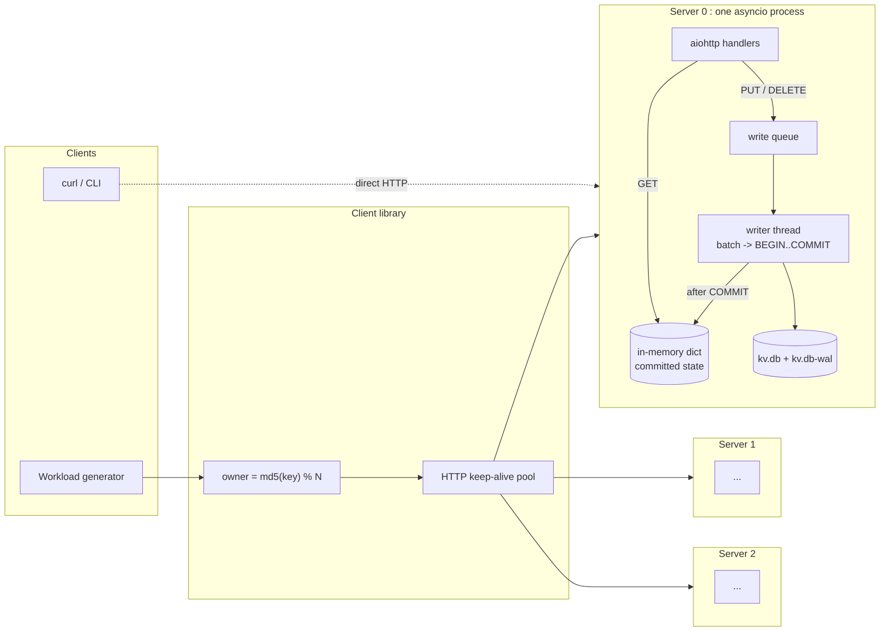
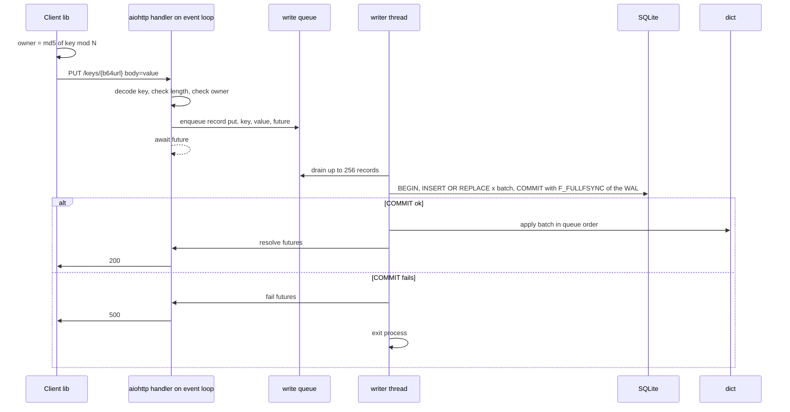
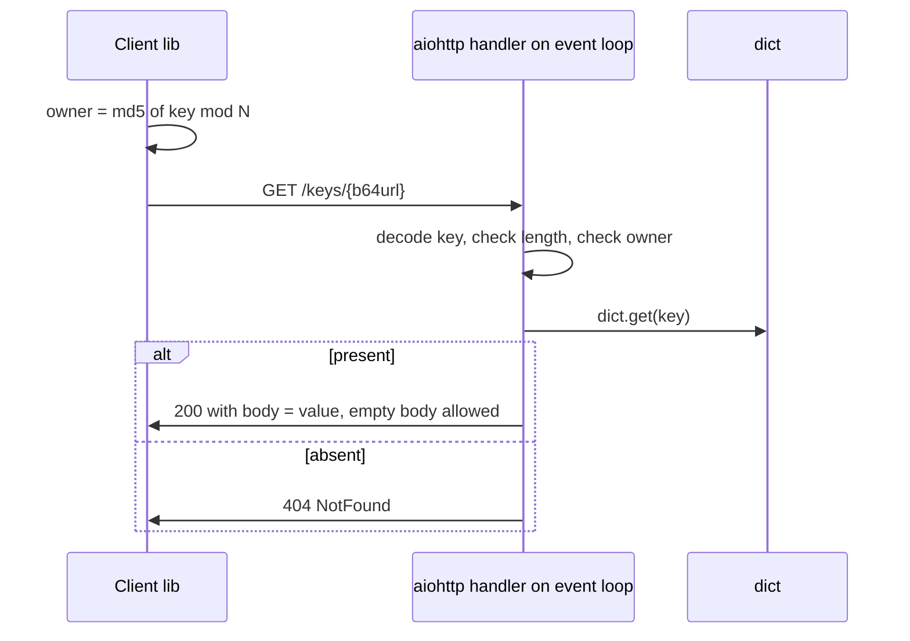

# Design: Distributed Key-Value Store (v1)

Scope and constraints: [requirement.md](requirement.md). Measurements behind the choices:
[../spike/README.md](../spike/README.md).

## 1. Overview

v1 is N independent storage servers (N = 1..4), each owning a disjoint slice of the key space.
There is no replication. A client library hashes each key to its owner and talks to that server
over HTTP/1.1. Each server is one asyncio process with a SQLite database on disk and a full
in-memory copy of the committed state for reads. Writes are batched into one SQLite
transaction per batch on a single writer thread; a request is acknowledged only after that
transaction has committed with a full fsync.

| Decision | Choice | Reason |
|----------|--------|--------|
| Language / runtime | Python 3, one asyncio process per server | Measured 14–20% CPU at 1K ops/s; single-threaded apply gives per-key ordering without locks |
| Wire protocol | HTTP/1.1 via aiohttp, key as base64url in the path, raw body as value | curl-debuggable; measured p99 equal to raw TCP |
| Routing | Client-side `md5(key) % N` over a static server list | One hop; no router process |
| Storage | SQLite, WAL, `synchronous=FULL`, `fullfsync=ON`, `checkpoint_fullfsync=ON` | Durability, crash recovery and space reuse come from SQLite; fullfsync is required on macOS |
| Durability | One transaction per batch (group commit); ack after COMMIT | Per-write fullfsync costs ~4 ms; batching brings it to ~0.3 ms per write |
| Visibility | Apply to the in-memory dict only after COMMIT (apply-after-commit) | No client can read a value that could vanish on restart |
| Failure policy | On COMMIT failure: fail the batch with 500, exit the process | Disk state after an fsync error is uncertain; restart reloads the committed state |

## 2. Architecture



Per server, the components are:

- **aiohttp handlers** on the event loop. GET is a dict lookup. PUT/DELETE enqueue a write
  record with a future and await it.
- **Write queue**, a `queue.Queue` shared between the event loop and the writer thread.
- **Writer thread**, the only thread that touches SQLite after startup and the only code that
  mutates the dict. It drains the queue into a batch of up to 256 records, runs one
  transaction, and on success applies the batch to the dict in queue order, then resolves the
  futures through `loop.call_soon_threadsafe`.
- **In-memory dict**, `bytes -> bytes`. Invariant: the dict always equals the committed state
  of the database. It is loaded from the database at startup and modified only by the writer
  after COMMIT.
- **SQLite file** `kv.db` with its `-wal` and `-shm` companions. Schema:
  `CREATE TABLE kv(k BLOB PRIMARY KEY, v BLOB NOT NULL) WITHOUT ROWID`.

Per-key linearizability follows from the single writer: all writes to a key are serialized in
queue order, acks are issued in that order after commit, and a read sees either the committed
value before a write or after it, never an uncommitted one.

## 3. Request flows

### Put



Delete is identical with `DELETE FROM kv WHERE k=?` and `dict.pop(key, None)`. Deleting an
absent key still goes through the batch so its ack carries the same durability meaning.

### Get



A Get never touches SQLite or the writer thread. A write that is in the queue or in an
uncommitted transaction is invisible to it, which is what makes apply-after-commit safe.

## 4. Per-key linearizability

The guarantee: for each key, all Put, Delete and Get operations behave as if executed one at a
time in a single order that respects real time. If an operation completes before another
starts, it comes first in that order. The mechanisms are the single writer thread, the FIFO
write queue, and apply-after-commit. No application-level locks are used.

| Scenario | What happens | Why it holds |
|----------|--------------|--------------|
| Put then Get, same client, Get sent after the 200 | Get returns the value written or a later one | The 200 is sent only after the writer applied the value to the dict, which happens after COMMIT. Any Get that starts later reads the dict and sees it |
| Delete then Get, Get sent after the 200 | Get returns 404 unless a later Put recreated the key | Same path: the key is removed from the dict before the 200 is sent |
| Concurrent Put and Put on one key | Both get 200; the final value is the one that entered the queue later | Records are drained in FIFO order into one transaction and applied to the dict in that order; the last SQL statement for a key and the last dict assignment agree |
| Concurrent Put and Delete on one key | Both get 200; the outcome is whichever entered the queue later | Same as above. Delete is a normal record in the batch, not a special case |
| Get concurrent with an in-flight Put | Get returns either the old value or the new one, never a torn or uncommitted value | The dict holds only committed values. Before apply the Get sees the old value; after apply it sees the new one. Either result is a valid linearization because the operations overlap |
| Reads never go backwards | If any reader sees value v for a key, every later reader sees v or a later write | The dict is mutated only by the writer in queue order, and nothing ever rolls the dict back. A value that is visible has already been committed and cannot be undone by a crash |
| Acked write, then restart | After the server restarts the Get returns the acked value, or a later acked write | The 200 required COMMIT to return with the WAL flushed by F_FULLFSYNC. Startup replays the WAL and loads the dict from the committed table. Writes that were queued but not committed are lost, and no client ever received a 200 for them |
| Batch fails to commit | Every request in the batch gets 500, no value in it becomes visible, the server exits | Apply happens only on the success path. Exiting prevents a later batch from committing on top of uncertain disk state |

Cross-key ordering is not guaranteed and not needed: two keys may live on different servers and
their writes commit independently.

## 5. API

Base URL: `http://host:port`. Key is base64url without padding, decoded on the server.
Values are raw bytes in the request or response body, `Content-Type: application/octet-stream`.

| Operation | Request | Success | Errors |
|-----------|---------|---------|--------|
| Put | `PUT /keys/{key}` body = value (0..65536 bytes) | 200, empty body | 400 bad key, 413 value too large, 421 wrong owner, 500 commit failed |
| Get | `GET /keys/{key}` | 200, body = value (empty body for empty value) | 404 key absent, 400, 421 |
| Delete | `DELETE /keys/{key}` | 200, also for an absent key | 400, 421, 500 |

Error semantics:

| Status | Meaning | Body |
|--------|---------|------|
| 400 | key not valid base64url, empty, or longer than 256 bytes after decoding | text reason |
| 404 | key does not exist (Get only) | `NotFound` |
| 413 | value longer than 64 KiB | text reason |
| 421 | this server is not the owner of the key | `WRONG_OWNER <owner index>` |
| 500 | transaction failed; the write was not applied; the server is exiting | text reason |

Put returns 200 for both create and replace. A client that times out may retry; Put and Delete
are idempotent for the same value.

## 6. Configuration

One file, `cluster.json`, read by every server and by the client library, so N, ordering and
addresses cannot drift:

```json
{
  "servers": [
    {"id": 0, "host": "127.0.0.1", "port": 7300, "data_dir": "data/s0"},
    {"id": 1, "host": "127.0.0.1", "port": 7301, "data_dir": "data/s1"},
    {"id": 2, "host": "127.0.0.1", "port": 7302, "data_dir": "data/s2"}
  ],
  "max_batch": 256
}
```

- `N = len(servers)`; owner of a key is `servers[md5(key) % N]`. The order of the list is part
  of the configuration and must not change while data exists.
- A server is started as `kvserver --config cluster.json --id 0`. It owns `data_dir/kv.db`.
- SQLite pragmas on the writer connection: `journal_mode=WAL`, `synchronous=FULL`,
  `fullfsync=ON`, `checkpoint_fullfsync=ON`.
- Scripts: `scripts/start.sh` launches every server in the file in the background, writes pid
  files to `data/sX/kvserver.pid`, and waits until each port accepts a TCP connection.
  `scripts/stop.sh` sends SIGTERM to each pid. The scripts never delete `kv.db`, `kv.db-wal`
  or `kv.db-shm`.

## 7. Startup and recovery

Startup, in order, before the port is opened:

1. Open `kv.db`, set pragmas, create the table if missing. SQLite replays the WAL here if the
   previous process died mid-write, so the database reaches the last committed transaction.
2. `SELECT k, v FROM kv` into the dict. This is the only read connection ever opened, and it is
   closed when the load finishes so it can never block a checkpoint.
3. Start the writer thread with its own connection.
4. Start listening. A client that can connect sees a server whose dict is complete.

What survives what:

| Event | Acked writes | Unacked writes in flight | Mechanism |
|-------|--------------|--------------------------|-----------|
| SIGTERM | kept | lost, same as a crash; clients saw a timeout, never a 200 | WAL recovery on open |
| SIGKILL / crash | kept | lost; clients saw a timeout, never a 200 | WAL recovery on open |
| Power loss | kept | lost | `synchronous=FULL` + `fullfsync=ON` flush the WAL to the medium before COMMIT returns |
| COMMIT error at runtime | kept up to the last good commit | batch gets 500 | fail-stop, then restart reloads committed state |
| Loss of the server's disk | lost | lost | out of scope for v1 (no replication) |

Checkpointing: SQLite auto-checkpoints when the WAL passes 1000 pages, inside a COMMIT on the
writer thread. With `checkpoint_fullfsync=ON` that commit pays an extra full fsync. Since no
connection holds a read transaction after startup, checkpoints always complete and the WAL
stays bounded.

## 8. Test strategy

| Level | What | How |
|-------|------|-----|
| Unit | key decoding, length limits, owner check, status codes, empty value vs absent | pytest against the aiohttp app with `aiohttp.test_utils` |
| Unit | writer thread: batch applied to dict only after COMMIT, nothing applied and process exits on a forced COMMIT failure | inject a failing SQLite connection |
| Integration | three servers from `cluster.json`, client library routes Put/Get/Delete, 421 on misrouted key | start via `scripts/start.sh`, drive with the client library |
| Restart (A8) | acked writes survive SIGKILL mid-load | run the generator, SIGKILL one server during writes, restart it, verify every acked Put is readable and every acked Delete returns 404; `-wal` and `-shm` files are left in place |
| Performance | 1K ops/s, 80/15/5, p99 read < 50 ms and write < 100 ms | open-loop generator at 1,000 ops/s for 60 s against N=1 and N=3; report p50/p95/p99/p999 measured client-side; spike baseline: put p99 11 ms (N=1), 18 ms (N=3) |
| Durability pragma | `fullfsync` really on | startup asserts `PRAGMA fullfsync` returns 1 and `PRAGMA synchronous` returns 2 |

Workload generator (`kvbench`): open-loop at a fixed arrival rate, 32 keep-alive connections
per server, uniform keys over 100K, 80% Get / 15% Put / 5% Delete, 1 KiB values, histogram
report printed and saved as CSV.

## 9. Out of scope for v1

Replication and consensus, failover, partition handling, write-queue backpressure, health
endpoint, graceful drain on SIGTERM, consistency checker in the workload generator, server-side
latency logging, VACUUM, metrics endpoint, TLS, auth.
